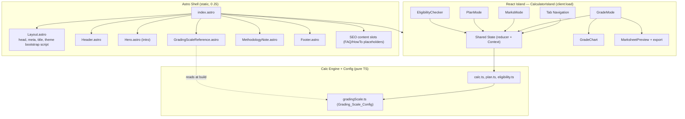
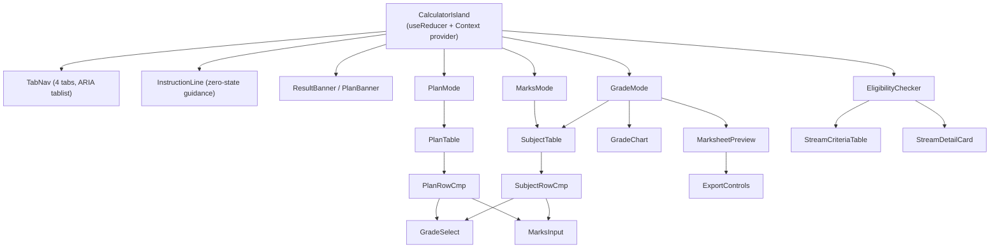

# Design Document

## Overview

The SEE GPA Calculator is a static, ad-free Astro site with a single React island that hosts all interactive behavior. The Astro layer (the `Astro_Shell`) renders the page chrome, static reference content, methodology notes, and SEO meta with zero client JavaScript. The React island (`CalculatorIsland`, mounted `client:load`) owns all calculator state and the four interaction methods: **Grade**, **Marks**, **Plan**, and **+2 Eligibility**.

The cornerstone of the design is a strict separation between three concerns:

1. **Config** (`src/config/gradingScale.ts`) — the single `Grading_Scale_Config` source of truth. Every grade band, grade point, percentage threshold, credit hour, subject definition, min-marks table, pass threshold, and stream eligibility rule lives here as a named constant. No literal grading value appears anywhere else.
2. **Calculation engine** (`src/lib/`) — pure, framework-agnostic, fully unit-testable functions that turn marks/grades into percentages, grade bands, subject grade points, and a final GPA. The engine imports from config and contains no React and no DOM.
3. **UI** (`src/components/`) — the React island and its subcomponents render state and dispatch user intents; they call the engine but never embed calculation literals.

This layering directly serves the requirements: it makes NEB policy changes a single-file edit (Requirement 2), keeps the static shell logic-free (Requirement 1.1, 1.3), guarantees the calculation methodology is centralized and testable (Requirement 7), and keeps the shipped JavaScript minimal (Requirement 21).

### Methodology note (prominent)

The official NEB SEE GPA is computed by **weighting grade points, not raw marks**. For each subject, theory and practical components are each converted to a percentage, each percentage is mapped to a discrete grade band (and its grade point), and the subject grade point is the weighted average of the *component grade points*. The final GPA is the credit-hour-weighted average of *subject grade points*. Raw marks are never summed or averaged directly. This distinction is documented here, in code comments on the engine functions, and in `docs/methodology.md` (Requirement 23.3).

## Architecture

### Shell vs Island boundary



The shell composes static sections and mounts exactly one island. The grading-scale reference section (`GradingScaleReference.astro`, Requirement 18) imports values from the config at build time so the static table and the interactive calculator never disagree.

### Where shared state lives

All interactive state lives inside `CalculatorIsland` in a single state container managed by `useReducer`, exposed to descendants through React Context. This single container is the `Shared_State`. Because Grade, Marks, and Plan all read and write the *same* subject array, switching tabs preserves data with no reset (Requirement 3.2). The most recently computed GPA is stored in the container so the Eligibility tab can auto-pull it (Requirement 3.4, 15.1).

### Rendering and hydration strategy

- The shell sections are pure Astro and ship no JS (Requirement 21.2).
- `CalculatorIsland` mounts with `client:load` so the calculator is interactive immediately on load (Requirement 1.2).
- Only the island and its dependencies (React, the engine, and export libraries which are dynamically imported on demand) reach the browser (Requirement 21.1).

## Tech Stack and Dependencies

### Additions

| Package | Purpose | Justification |
|---|---|---|
| `@astrojs/react` | Astro React integration | Required to render and hydrate the single island (Requirement 1.2). Installed via `npx astro add react`, which also wires `react`, `react-dom`, `@types/react`, `@types/react-dom`, and the `astro.config.mjs` `integrations: [react()]` entry. |
| `react`, `react-dom` | Island runtime | Peer dependencies of the integration. |
| `html2canvas` | Marksheet PNG export | Required by Requirement 17.4. Dynamically imported only when the user triggers PNG export, so it is excluded from the initial bundle. |
| `jspdf` | Marksheet PDF export | Required by Requirement 17.5. Dynamically imported only when the user triggers PDF export. |

### Charting approach (Requirement 16, 21)

No charting library is added. The `GradeChart` is **hand-rolled with CSS/flex bars** (or a tiny inline SVG) driven by per-subject grade points scaled against the 4.0 maximum. This keeps the bundle small per Requirement 21.1, avoids a heavy dependency for a single simple bar visualization, and inherits theme colors directly from the CSS variables. The chart renders only in Grade mode (Requirement 16.2).

### Integration steps (verified against Astro docs)

1. `npx astro add react` — installs `@astrojs/react`, `react`, `react-dom`, type packages, and updates `astro.config.mjs` to `integrations: [react()]` (keeping the existing `vite.plugins: [tailwindcss()]`).
2. Ensure `tsconfig.json` has `compilerOptions.jsx: "react-jsx"` and `jsxImportSource: "react"` (added automatically by `astro add react`; verify and add manually if missing).
3. `npm install html2canvas jspdf` — pinned to exact resolved versions in `package.json`.
4. Tailwind v4 stays CSS-first: no `tailwind.config.js`; all theme tokens live in `src/styles/global.css` under `@theme` (Requirement 1.5).

The final `astro.config.mjs`:

```js
// @ts-check
import { defineConfig } from 'astro/config';
import tailwindcss from '@tailwindcss/vite';
import react from '@astrojs/react';

export default defineConfig({
  integrations: [react()],
  vite: { plugins: [tailwindcss()] },
});
```

## Tailwind v4 Theme Token Mapping

All design tokens from `DESIGN.md` are mapped into Tailwind v4 `@theme` CSS variables in the single global stylesheet `src/styles/global.css` (Requirement 1.6, 19.4). Color, border-radius, brand color, and border color are global variables so visual changes happen in one place. Dark mode is handled with a class-based custom variant and a second set of variable values scoped to `.dark`.

### Structure of `global.css`

```css
@import "tailwindcss";

/* Class-based dark mode: `dark:` utilities activate under .dark */
@custom-variant dark (&:where(.dark, .dark *));

@theme {
  /* Typography */
  --font-sans: "Geist", "Inter", system-ui, -apple-system, sans-serif;
  --font-mono: "Geist Mono", ui-monospace, SFMono-Regular, Menlo, monospace;

  /* Radius scale (DESIGN.md `rounded`) */
  --radius-xs: 4px;
  --radius-sm: 6px;   /* base UI radius */
  --radius-md: 8px;   /* cards */
  --radius-lg: 12px;
  --radius-xl: 16px;
  --radius-pill: 100px;
  --radius-full: 9999px;

  /* Brand + semantic palette (light defaults from DESIGN.md colors) */
  --color-brand: #171717;       /* primary / ink */
  --color-on-brand: #ffffff;
  --color-ink: #171717;
  --color-body: #4d4d4d;
  --color-mute: #888888;
  --color-hairline: #ebebeb;    /* border color */
  --color-hairline-strong: #a1a1a1;
  --color-canvas: #ffffff;
  --color-canvas-soft: #fafafa;
  --color-canvas-soft-2: #f5f5f5;
  --color-link: #0070f3;
  --color-success: #0070f3;
  --color-error: #ee0000;
  --color-error-soft: #f7d4d6;
  --color-warning: #f5a623;
  --color-warning-soft: #ffefcf;
  --color-warning-deep: #ab570a;
}

/* Dark theme overrides — same variable names, inverted values.
   Only surface/text/border tokens flip; brand accents stay legible. */
.dark {
  --color-brand: #ededed;
  --color-on-brand: #171717;
  --color-ink: #ededed;
  --color-body: #a1a1a1;
  --color-mute: #8f8f8f;
  --color-hairline: #2e2e2e;
  --color-hairline-strong: #4d4d4d;
  --color-canvas: #0a0a0a;
  --color-canvas-soft: #111111;
  --color-canvas-soft-2: #1a1a1a;
  --color-link: #3b9eff;
  --color-error-soft: #2d1416;
  --color-warning-soft: #2b220f;
}
```

Because dark values override the same `--color-*` names, components can use plain utilities like `bg-canvas text-ink border-hairline` and automatically adapt when `.dark` is present on `<html>`. The `dark:` variant is reserved for cases that need a value that is not a simple token swap (e.g., shadow strength).

### Theme controller and FOUC avoidance

`Theme_Controller` defaults to system preference (Requirement 19.1) and offers a toggle (19.2, 19.3). To avoid a flash of the wrong theme (FOUC), a tiny **inline, render-blocking script in the `<head>`** of `Layout.astro` sets the `.dark` class before first paint:

```html
<script is:inline>
  (() => {
    const stored = localStorage.getItem("see-theme"); // "light" | "dark" | null
    const prefersDark = matchMedia("(prefers-color-scheme: dark)").matches;
    const dark = stored ? stored === "dark" : prefersDark;
    document.documentElement.classList.toggle("dark", dark);
  })();
</script>
```

The React toggle updates `localStorage` and toggles the same class. On first load with no stored choice, system preference wins; an explicit user choice persists. The toggle button lives inside the island (it is interactive), but the initial class is applied by the inline shell script so there is no flash.

## Config Module Shape (`Grading_Scale_Config`)

File: `src/config/gradingScale.ts`. This is the single source of truth (Requirement 2). All types are TypeScript interfaces; all values are exported `const`s.

```ts
export type LetterGrade = "A+" | "A" | "B+" | "B" | "C+" | "C" | "D" | "NG";
export type SplitType = "75-25" | "50-50";

/** One contiguous percentage band: lower inclusive, upper exclusive,
 *  except the top band where upper is inclusive (handled by lookup). */
export interface GradeBand {
  grade: LetterGrade;
  gradePoint: number;   // 0.0 .. 4.0
  minPercent: number;   // inclusive lower bound
  maxPercent: number;   // exclusive upper bound (top band inclusive of 100)
  description: string;  // e.g. "Outstanding"
}

export type GradingScale = GradeBand[]; // ordered high -> low, contiguous, gap-free

/** GPA -> letter band: contiguous, inclusive lower / exclusive upper,
 *  top band inclusive of 4.00. */
export interface GpaLetterBand {
  grade: LetterGrade;
  minGpa: number;  // inclusive
  maxGpa: number;  // exclusive, top band inclusive of 4.00
}

export interface SubjectDefinition {
  id: string;
  name: string;
  creditHours: number;
  splitType: SplitType;     // "50-50" drives CS behavior (Req 2.3, 6) — never name matching
  theoryMax: number;        // 75 standard, 50 for CS
  practicalMax: number;     // 25 standard, 50 for CS
  isCompulsory: boolean;
  nameLocked: boolean;      // compulsory => true
}

export interface StreamEligibilityRules {
  stream: "Science" | "Management" | "Humanities";
  minGpa: number;
  /** per-subject minimum grade points, keyed by required-subject id */
  subjectMinGp: Partial<Record<RequiredSubjectId, number>>;
}
```

### Grading scale (Requirement 7.1)

`GRADING_SCALE: GradingScale` defines, high to low:

| Grade | GP | Range | Description |
|---|---|---|---|
| A+ | 4.0 | 90 ≤ p ≤ 100 | Outstanding |
| A  | 3.6 | 80 ≤ p < 90 | Excellent |
| B+ | 3.2 | 70 ≤ p < 80 | Very Good |
| B  | 2.8 | 60 ≤ p < 70 | Good |
| C+ | 2.4 | 50 ≤ p < 60 | Satisfactory |
| C  | 2.0 | 40 ≤ p < 50 | Acceptable |
| D  | 1.6 | 35 ≤ p < 40 | Partially Acceptable |
| NG | 0.0 | 0 ≤ p < 35 | Not Graded |

### GPA → letter mapping function (Requirement 2.4, 2.5, 7.7)

```ts
export const GPA_LETTER_BANDS: GpaLetterBand[] = [/* A+ 3.6–4.00, A 3.2–3.6, ... */];

/** Pure. Clamps to [0,4] then returns exactly one LetterGrade. */
export function gpaToLetter(gpa: number): LetterGrade {
  const g = Math.min(4, Math.max(0, gpa)); // clamp (Req 2.5)
  // top band inclusive of 4.00; others inclusive-lower/exclusive-upper
  ...
}
```

### Compulsory subjects (Requirement 4.1, 4.2)

`COMPULSORY_SUBJECTS: SubjectDefinition[]` — all `isCompulsory: true`, `nameLocked: true`, `splitType: "75-25"`, `theoryMax: 75`, `practicalMax: 25`:

1. Nepali (CH 5)
2. English (CH 5)
3. Mathematics (CH 5)
4. Science and Technology (CH 5)
5. Social Studies (CH 4)
6. Health, Population & Environment (CH 4)

### Optional subject quick-select (Requirement 5.1, 5.2)

```ts
export const OPTIONAL_I_CHOICES = ["Optional Mathematics", "Economics"]; // CH 4
export const OPTIONAL_II_CHOICES = ["Accountancy", "Computer Science"];  // CH 4
// Computer Science is created with splitType "50-50", theoryMax 50, practicalMax 50.
export const DEFAULT_OPTIONAL_CH = 4;
```

### Pass-threshold constants (Requirement 8)

```ts
export const NG_PERCENT_FLOOR = 35;        // below 35% => NG (Req 8.1)
export const PASS_THRESHOLDS = {
  "75-25": { theoryMinMarks: 27, practicalMinMarks: 9 },   // /75, /25 (Req 8.2)
  "50-50": { theoryMinMarks: 18, practicalMinMarks: 18 },  // /50, /50 (Req 8.3)
};
```

### Theory minimum-marks tables (Requirement 13.4, 13.5)

These are derived from `ceil(minPercent × theoryMax / 100)` but stored explicitly for verification and display:

```ts
export const THEORY_MIN_MARKS = {
  "75-25": { "A+": 68, "A": 60, "B+": 53, "B": 45, "C+": 38, "C": 30, "D": 27 }, // /75
  "50-50": { "A+": 45, "A": 40, "B+": 35, "B": 30, "C+": 25, "C": 20, "D": 18 }, // /50 (CS)
};
```

A unit test asserts these literals equal `ceil(minPercent × theoryMax / 100)` for each band so the table can never silently drift from the scale.

### Stream eligibility rules (Requirement 15.3–15.6)

Required-subject ids: `english | nepali | socialStudies | math | science`.

```ts
export const STREAM_RULES: StreamEligibilityRules[] = [
  { stream: "Science",    minGpa: 2.0, subjectMinGp: { science: 2.4, math: 2.4, english: 1.6, nepali: 1.6, socialStudies: 1.6 } },
  { stream: "Management", minGpa: 1.6, subjectMinGp: { english: 1.6, nepali: 1.6, math: 1.6, science: 1.6, socialStudies: 1.6 } },
  { stream: "Humanities", minGpa: 1.6, subjectMinGp: { english: 1.6, nepali: 1.6, socialStudies: 1.6 } },
];
```

All thresholds are numeric grade points compared numerically, never grade strings (Requirement 15.3).

## Core Calculation Engine

Files: `src/lib/calc.ts` (grading + GPA), `src/lib/plan.ts` (Plan solver), `src/lib/eligibility.ts` (stream evaluation). All functions are pure and import thresholds only from config.

### Data types used by the engine

```ts
export interface ComponentResult { grade: LetterGrade; gradePoint: number; isFailing: boolean; }
export interface SubjectResult {
  subjectGp: number;          // unrounded weighted subject grade point
  theory: ComponentResult;
  practical: ComponentResult;
  isNg: boolean;              // any component NG or failing
}
export interface GpaResult {
  gpa: number;                // rounded to 2dp, round-half-up
  letter: LetterGrade;
  passed: boolean;            // false if any contributing subject is NG/failing
  perSubject: Record<string, SubjectResult>;
}
```

### Functions

```ts
// marks -> percentage; unrounded, retained in [0,100] (Req 7.2)
marksToPercent(marks: number, max: number): number   // (marks/max)*100

// percentage -> grade band via contiguous lookup (Req 7.1, 7.2)
// inclusive lower, exclusive upper; top band inclusive of 100
percentToBand(percent: number): GradeBand

// component grade + failing flag from marks (Req 8)
gradeComponentFromMarks(marks: number, max: number, splitType): ComponentResult

// subject GP from two component grade points, weighted per splitType (Req 6.2, 6.4, 7.4)
// "50-50": th*0.5 + pr*0.5 ; "75-25": th*0.75 + pr*0.25
subjectGradePoint(theoryGp: number, practicalGp: number, splitType): number

// final GPA: sum(CH*subjectGp)/sum(CH), unrounded intermediates,
// then round-half-up to 2dp (Req 7.5, 7.6)
computeGpa(subjects: ScoredSubject[]): GpaResult

// round half away from zero to 2 decimals (Req 7.6)
roundHalfUp2(x: number): number
```

`roundHalfUp2` uses an epsilon-safe implementation to avoid binary-float artifacts (e.g. `2.675`): scale by 100, add a tiny epsilon in the direction of the sign, `Math.round`, divide by 100. The summation keeps full-precision `subjectGp` values and only the final GPA is rounded (Requirement 7.5).

### Band lookup detail

`percentToBand` walks `GRADING_SCALE` and returns the band where `percent >= minPercent && (percent < maxPercent || (isTopBand && percent <= 100))`. Bands are contiguous and gap-free by construction; a unit/property test verifies no gaps or overlaps across `[0,100]`.

## Data Models

### Subject row state (Shared_State)

```ts
interface SubjectRow {
  id: string;
  name: string;
  creditHours: number;
  splitType: SplitType;
  theoryMax: number;
  practicalMax: number;
  isCompulsory: boolean;
  nameLocked: boolean;
  // Grade mode inputs (letter selections; "" = unselected "--")
  theoryGrade: LetterGrade | "";
  practicalGrade: LetterGrade | "";   // defaults to "A+" (Req 9.2)
  // Marks mode inputs (raw marks or null)
  theoryMarks: number | null;
  practicalMarks: number | null;
}
```

### Top-level island state

```ts
type Tab = "grade" | "marks" | "plan" | "eligibility";
type InputUnit = "grade" | "marks"; // last edited unit per row, for sync

interface CalculatorState {
  subjects: SubjectRow[];      // shared across grade/marks/plan
  activeTab: Tab;
  theme: "light" | "dark";
  lastComputedGpa: number | null;  // feeds Eligibility (Req 3.4, 15.1)
  plan: {
    targetGpa: number | null;
    editPracticals: boolean;
    message: string | null;    // estimate / max / min notices
  };
  eligibility: {
    manualGpa: number | null;
    requiredGrades: Record<RequiredSubjectId, LetterGrade | "">;
    result: EligibilityResult | null;
  };
  errors: Record<string, string>; // keyed by field id for inline errors
}
```

The reducer actions cover: set tab, add/remove optional subject, set theory/practical grade, set theory/practical marks (with clamp on blur), run plan, set plan target, sync grade↔marks, toggle edit-practicals, set eligibility input, run eligibility check, toggle theme.

### Marksheet model (Requirement 17.3)

```ts
interface MarksheetRow {
  serial: number; subject: string; creditHours: number;
  theoryMarks: number | null; theoryGrade: LetterGrade;
  practicalMarks: number | null; practicalGrade: LetterGrade;
  finalGrade: LetterGrade; gradePoint: number; remark: "Passed" | "Not Passed";
}
interface Marksheet { rows: MarksheetRow[]; gpa: number; letter: LetterGrade; result: "Passed" | "Not Passed"; }
```

## Components and Interfaces

### React island decomposition



**Shared-state model.** `CalculatorIsland` creates the reducer state and provides it via `CalculatorContext`. Grade, Marks, and Plan views render from the *same* `subjects` array, so a grade typed in Grade mode is visible as marks-derived data and vice versa; switching tabs never resets (Requirement 3.2). When the Eligibility or Plan tab opens, it reads from this shared state (Requirement 3.3, 3.4). This single-container approach is the mechanism that satisfies the "no data loss across tabs" requirement.

### Component contracts

- **TabNav** — renders four tabs ("Grade", "Marks", "Plan", "+2 Eligibility") as an ARIA `tablist`; dispatches `setTab`. Roving tabindex + arrow-key navigation (Requirement 3.1, 3.5, 20.2).
- **SubjectTable / SubjectRowCmp** — columns Subject, CH, Theory, Practical, Final Grade, Grade Point, Remark, and a delete control rendered only on optional rows (Requirement 11.1, 4.4, 5.5). Compulsory names render as locked text (Requirement 4.3).
- **GradeSelect** — an accessible listbox/combobox dropdown (ARIA `combobox`+`listbox` pattern, Requirement 20.3) showing each option as "A+ (4.00)" (Requirement 9.1). Used for grade selection in Grade mode and Plan target grade.
- **MarksInput** — numeric input bounded by the row's configured max; clamps to `[0, max]` and shows an inline error on blur (Requirement 10.2, 13.6). Emits derived grade live (Requirement 10.3).
- **ResultBanner** — shows GPA + mapped letter, or "—" in the zero state (Requirement 9.3, 9.5, 11.3); shows red NG/fail warning naming affected subjects (Requirement 8.5, 10.5).
- **GradeChart** — CSS/SVG bar chart of per-subject grade points; Grade mode only (Requirement 16).
- **MarksheetPreview + ExportControls** — simulated marksheet and PNG/PDF export (Requirement 17).
- **EligibilityChecker** — required-subject grade inputs, GPA field, Check action, verdict, per-stream detail cards, and always-visible criteria reference table (Requirement 15).

### Zero state (Requirement 11)

On first load the six compulsory rows render with grade cells showing "--" (Requirement 11.2), the GPA banner shows "—" (Requirement 11.3), and an instruction line sits above the table (Requirement 11.4). This presentation applies across all four tabs (Requirement 11.5).

## Grade Mode (Requirement 9)

- Theory and practical render as `GradeSelect` dropdowns showing "A+ (4.00)" style labels (9.1).
- New rows default practical to A+ and leave theory empty with "--" placeholder (9.2).
- While a subject's theory is empty, its Final Grade and Grade Point show "—" (9.3); once theory is selected, the subject result computes live (9.4).
- The GPA banner shows "—" while any compulsory subject lacks a theory grade (9.5); when all compulsory subjects have theory grades, the banner shows the GPA + letter (9.6).
- On a complete calculation, the `GradeChart` (16) and `MarksheetPreview` (17) render below the results.

## Marks Mode (Requirement 10)

- Theory/practical marks inputs bounded by the subject's configured maxes (10.1).
- On blur, out-of-range values clamp to `[0, max]` with an inline error (10.2).
- Valid marks derive and display Final Grade and Grade Point live (10.3) via `gradeComponentFromMarks` + `subjectGradePoint`.
- Components below pass thresholds get a red badge (10.4); any NG subject triggers a banner warning (10.5).

## Plan Mode Design (Requirement 12, 13, 14)

### Auto-fill solver (Requirement 12)

Triggered by the "Plan" control; must complete within 1s (12.11 — trivially met, it is closed-form + a bounded greedy loop):

1. **Validate target.** If target is non-numeric or > 4.0, do not apply; preserve previous suggestion/empty state; show inline error stating max is 4.00 and a value within 0.00–4.00 is required (12.6).
2. **Lock practicals at A+ (GP 4.0).** Compute `practicalContribution = Σ(CH × 4.0 × practicalWeight)`, where `practicalWeight` is 0.25 standard / 0.50 for `50-50` (12.3).
3. **Solve uniform theory GP** = `(targetGpa × totalCH − practicalContribution) / Σ(CH × theoryWeight)` (12.4).
4. **Snap down** the solved theory GP to the nearest discrete grade point in `GRADING_SCALE` and assign to all subjects (12.4).
5. **Greedy bump.** While computed GPA < target, raise the subject with the highest credit hours by one grade (ties broken deterministically by subject order), repeat until GPA ≥ target or no subject can be raised (12.5).
6. **Edge results:**
   - If reachable only with all subjects at A+, assign A+ to all and show "Maximum achievable GPA is 4.00." (12.7).
   - If target is 0 or below the minimum passing achievable 1.60 (all D), assign D to all and show the minimum-passing note (12.8).
   - If the exact target is not achievable on discrete grades, fill to the nearest achievable GPA **at or above** target and label the result an estimate (12.2, 12.9).
7. Leave all suggested cells editable (12.10).

The solver is a pure function `planForTarget(subjects, targetGpa): { suggestion: SubjectRow[]; message: string | null }` in `src/lib/plan.ts`.

### Two-way grade ↔ min-marks sync (Requirement 13)

Plan columns: Subject, CH, Target Theory Grade, Min Theory Marks, Practical, Subject GP, Action (13.1).

- Changing **Target Theory Grade** sets Min Theory Marks to `ceil(minPercent × theoryMax / 100)` for that grade and recomputes Subject GP + overall GPA on the same change (13.2).
- Editing **Min Theory Marks** (whole number in `[0, theoryMax]`) converts to percent `(value/theoryMax)×100`, derives the band (percent below D floor → NG), updates the grade dropdown, and recomputes — same change, no separate calculate (13.3).
- Min-marks tables come from config `THEORY_MIN_MARKS` (13.4 standard, 13.5 CS).
- Out-of-range min-marks clamp to nearest bound with inline error, then recompute from the clamped value (13.6).
- Empty/non-numeric min-marks: retain last valid value, show "whole number required" error, leave GP/GPA unchanged (13.7).
- Practicals default to A+ (13.8); the "Edit practicals" toggle unlocks per-practical grade + min-marks inputs with the same sync rules (13.9).
- Adding/removing an optional subject re-runs the fill and recomputes on the same change (13.10).

The grade↔marks conversion uses two pure helpers: `gradeToMinMarks(grade, theoryMax)` and `marksToGrade(marks, theoryMax)`, both config-driven, guaranteeing round-trip consistency.

### Live result banner (Requirement 14)

`PlanBanner` shows Target GPA and Live GPA side by side, updating on every input change (14.1). Green when Live ≥ Target, amber when below, always showing the numeric delta (14.2, 14.3). If any subject drops to NG/below pass threshold, a warning names the affected subject and indicates not passed (14.4).

## Eligibility Checker Design (Requirement 15)

- **Overall GPA field** auto-populates from `lastComputedGpa` in shared state; editable in steps of 0.01 when no GPA was computed; manual entry clamps to `[0.00, 4.00]` with inline error (15.1, 15.10).
- **Required-subject grade dropdowns** for English, Nepali, Social Studies, Compulsory Mathematics, Compulsory Science only — each defaulting to "--"; no optional/other subjects shown (15.2). Dropdowns show grade + grade point.
- **Check action.** On activation, if any of the five required dropdowns is unselected, show an error identifying the missing subjects and render no verdict (15.11). Otherwise evaluate each stream against `STREAM_RULES` comparing numeric grade points (15.3–15.6) using a pure `evaluateEligibility(gpa, grades): EligibilityResult`.
- **Verdict** lists only passing streams (15.7); if none pass, show a "no +2 stream qualifies" message (15.12).
- **Per-stream detail cards** show each requirement with ✓/✗, failed requirements highlighted red (15.8).
- **Static criteria reference table** for all three streams is always visible, before any input (15.9), sourced from `STREAM_RULES`.

```ts
interface StreamVerdict {
  stream: "Science" | "Management" | "Humanities";
  passed: boolean;
  checks: { label: string; required: number; actual: number; pass: boolean }[];
}
interface EligibilityResult { qualifying: StreamVerdict["stream"][]; details: StreamVerdict[]; }
```

## Marksheet Design (Requirement 17)

The `MarksheetPreview` mirrors the official SEE marksheet layout (17.2) supplied as a reference image, positioned as a secondary feature that does not interrupt primary workflows (17.7).

**Columns:** Serial, Subject, Credit Hour, Obtained Grade (TH / PR), Final Grade, Grade Point, Remarks. **Footer:** overall GPA, mapped letter, and "Passed"/"Not Passed" result remark (17.3).

**Export:** A wrapping `<div ref>` is captured by `html2canvas` to produce a PNG download (17.4); the same canvas is placed into a jsPDF document for PDF download (17.5). Both libraries are dynamically imported on first export click to keep them out of the initial bundle. Download only — no shareable URL (17.6).

## Accessibility Design (Requirement 20)

- **WCAG 2.1 AA target** for the interactive interface (20.1). Note: full conformance requires manual testing with assistive technology and expert review; the design bakes in the structural requirements below.
- **Keyboard operability** (20.2): all inputs, dropdowns, tabs, toggles, and buttons reachable and operable by keyboard; visible focus rings using a token color with sufficient contrast.
- **ARIA dropdown pattern** (20.3): `GradeSelect` implements the combobox/listbox pattern — `role="combobox"`, `aria-expanded`, `aria-controls`, `aria-activedescendant`; the popup is `role="listbox"` with `role="option"` items; Up/Down/Home/End/Enter/Esc/type-ahead supported; focus returns to the trigger on close.
- **Tablist** for `TabNav` with arrow-key roving focus and `aria-selected`.
- **Color contrast** (20.1): grade/fail badges and result banners use the DESIGN.md semantic tokens (error `#ee0000`, warning `#f5a623`) with text colors chosen to meet 4.5:1 against their backgrounds; badges pair color with a text label/icon so color is not the sole signal.
- **Mobile-first responsive layout** (20.4): breakpoints from DESIGN.md — mobile < 600, tablet 600–959, desktop 960–1199, wide 1200–1399. The subject/plan tables collapse to stacked card rows on mobile; the tab pill row enables horizontal scroll; touch targets meet the 44×44px floor.

## Correctness Properties

*A property is a characteristic or behavior that should hold true across all valid executions of a system — essentially, a formal statement about what the system should do. Properties serve as the bridge between human-readable specifications and machine-verifiable correctness guarantees.*

The calculation engine, config functions, plan solver, and eligibility evaluator are pure functions with large input spaces, making them ideal for property-based testing. The following properties were derived from the prework analysis and deduplicated so each provides unique validation value.

### Property 1: GPA-to-letter mapping is total, single-valued, and clamped

*For any* real number input, `gpaToLetter` returns exactly one `LetterGrade`; for inputs within 0.0–4.0 the returned grade's band contains the value (inclusive lower, exclusive upper, top band inclusive of 4.00); for inputs below 0.0 the result equals `gpaToLetter(0)` and for inputs above 4.0 the result equals `gpaToLetter(4)`.

**Validates: Requirements 2.4, 2.5, 7.7**

### Property 2: Grading scale tiles [0,100] with no gaps or overlaps

*For any* percentage in 0–100, `percentToBand` returns exactly one band, and that band is the unique band whose `[minPercent, maxPercent)` interval (top band inclusive of 100) contains the percentage.

**Validates: Requirements 7.1, 7.2**

### Property 3: Grade derivation is monotonic in marks

*For any* two mark values within `[0, max]` for the same component max, a higher mark never produces a lower grade point than a lower mark.

**Validates: Requirements 7.2**

### Property 4: Subject grade point is the correct weighted combination of component grade points

*For any* theory grade point, practical grade point, and `splitType`, `subjectGradePoint` equals `theoryGp × theoryWeight + practicalGp × practicalWeight` where weights are 0.75/0.25 for `75-25` and 0.50/0.50 for `50-50`, and the result lies between the minimum and maximum of the two component grade points.

**Validates: Requirements 6.2, 6.4, 7.4**

### Property 5: Final GPA is the credit-hour-weighted mean of unrounded subject grade points, rounded half-up to 2dp

*For any* set of scored subjects with positive credit hours, `computeGpa` returns a value in 0.00–4.00 equal to `roundHalfUp2(Σ(CH × subjectGp) / Σ(CH))` using unrounded subject grade points in the summation; and when every subject shares the same subject grade point `g`, the GPA equals `roundHalfUp2(g)`.

**Validates: Requirements 7.5, 7.6**

### Property 6: Components below the configured pass threshold are flagged failing, and sub-35% is NG with GP 0

*For any* component marks and `splitType`, the component is flagged failing if and only if its marks are below the configured minimum for that `splitType` (theory/practical), and any component whose percentage is below 35 is graded NG with grade point 0.0.

**Validates: Requirements 8.1, 8.2, 8.3**

### Property 7: Pass status reflects the presence of any NG or failing component

*For any* set of scored subjects, `computeGpa(...).passed` is true if and only if no subject contains an NG or failing component, and the set of affected subjects reported equals exactly the subjects that contain an NG or failing component.

**Validates: Requirements 8.5, 10.5, 14.4**

### Property 8: Target grade and minimum theory marks are consistent round-trips

*For any* `LetterGrade` (A+ through D) and theory maximum, converting the grade to its minimum marks and back yields the same grade: `marksToGrade(gradeToMinMarks(grade, max), max) === grade`; and `marksToGrade` is idempotent under re-derivation of its own minimum marks.

**Validates: Requirements 13.2, 13.3**

### Property 9: Stored theory minimum-marks tables equal the formula derived from the scale

*For any* grade band and `splitType` theory maximum, the stored `THEORY_MIN_MARKS` value equals `ceil(band.minPercent × theoryMax / 100)`.

**Validates: Requirements 13.4, 13.5**

### Property 10: The plan solver reaches the target with valid discrete grades and locked practicals

*For any* set of subjects and target GPA within the achievable range, the solver assigns only discrete grade points from the configured scale to every subject, locks every practical at A+ (GP 4.0), and produces a resulting GPA that is at or above the target (the nearest achievable at-or-above value), or exactly 4.00 when the target is at the maximum.

**Validates: Requirements 12.3, 12.4, 12.5, 12.9**

### Property 11: Stream eligibility qualifies a stream exactly when all its configured conditions hold

*For any* overall GPA and set of the five required-subject grades, `evaluateEligibility` marks a stream as passed if and only if the GPA is at least the stream's configured minimum GPA and every required subject's grade point is at least the stream's configured per-subject threshold; and the verdict lists exactly the set of streams marked passed.

**Validates: Requirements 15.4, 15.5, 15.6, 15.7, 15.12**

### Property 12: Tab switching preserves shared subject data

*For any* calculator state and any sequence of tab-switch actions, the resulting `subjects` array is deep-equal to the original; only `activeTab` changes.

**Validates: Requirements 3.2**

### Property 13: The marksheet is complete and consistent with the computed GPA

*For any* set of scored subjects, the built marksheet contains exactly one row per subject, every row populates all required fields (serial, subject, credit hour, theory grade/marks, practical grade/marks, final grade, grade point, remark), the footer GPA and letter equal `computeGpa`, and the result remark is "Passed" when the computed pass status is true and "Not Passed" otherwise.

**Validates: Requirements 17.3**

### Property 14: Grade option labels include the grade and its 2-decimal grade point

*For any* `LetterGrade`, the formatted dropdown option label contains the grade string and its configured grade point formatted to two decimals (e.g. "A+ (4.00)").

**Validates: Requirements 9.1**

### Property 15: GPA is computable exactly when all compulsory theory grades are present

*For any* set of subjects, the GPA banner reports a numeric GPA if and only if every compulsory subject has a selected theory grade; otherwise it reports the "—" sentinel.

**Validates: Requirements 9.5, 9.6, 11.3**

## Error Handling

Input validation and clamping live in the engine/reducer (pure, testable), while presentation of errors is the UI's job.

- **Marks inputs (Marks mode, Requirement 10.2):** on blur, values outside `[0, max]` clamp to the nearest bound; an inline error message is shown for that field via `state.errors[fieldId]`. The derived grade recomputes from the clamped value.
- **Plan min-marks (Requirement 13.6, 13.7):** out-of-range whole numbers clamp to `[0, theoryMax]` with an inline range error, then recompute; empty/non-numeric input retains the last valid value, shows a "whole number required" error, and leaves GP/GPA unchanged.
- **Plan target (Requirement 12.6):** non-numeric or > 4.0 targets are rejected without mutating the suggestion; an inline error states the max is 4.00 and a value within 0.00–4.00 is required.
- **Eligibility GPA (Requirement 15.10):** manual GPA outside `[0.00, 4.00]` clamps to the nearest bound with an inline range error.
- **Eligibility missing inputs (Requirement 15.11):** activating Check with any of the five required grades unselected shows an error naming the missing subjects and renders no verdict.
- **NG / fail banners (Requirement 8.5, 10.5, 14.4):** when `computeGpa(...).passed` is false, a banner names the affected subjects and indicates the result is not passed; failing components carry a red badge that also includes a text label (not color alone, for accessibility).
- **Numeric precision:** `roundHalfUp2` guards against binary-float artifacts; intermediate subject grade points are never rounded before the final GPA (Requirement 7.5).

## Testing Strategy

A dual approach: property-based tests for universal engine/config correctness, and example/component tests for specific behaviors, edge cases, and UI interactions.

### Test runner

Use **Vitest** — Vite is already present in the project (Astro uses it and the Tailwind plugin is a Vite plugin), so Vitest integrates with zero extra build config. Add `@testing-library/react` and `jsdom` for component/interaction tests. Astro officially documents Vitest as the unit-test runner for Vite-based projects.

### Property-based tests

- Use **fast-check** (the standard PBT library for the TS/JS ecosystem). Do not hand-roll property testing.
- Each property test runs a **minimum of 100 iterations**.
- Each property test is tagged with a comment referencing its design property in the format:
  `// Feature: see-gpa-calculator, Property {number}: {property_text}`
- Each of the 15 correctness properties above is implemented by a **single** property-based test, with generators for: marks within/around component maxes, grade points, subject sets with valid credit hours, `splitType` values, target GPAs across and beyond `[0,4]`, and the five required eligibility grades.
- Generators deliberately include edge inputs: 0, exact band boundaries (35, 40, 50, 60, 70, 80, 90, 100), out-of-range marks/targets/GPA, empty subject sets, and all-NG sets — covering the EDGE_CASE criteria (12.6, 12.7, 12.8, 13.6, 15.10) through the property generators.

### Unit / example tests

Focused example tests for behaviors that are specific rather than universal:

- Plan edge cases: target > 4 / non-numeric rejected (12.6); target 4.0 → all A+ with "Maximum achievable GPA is 4.00." (12.7); target ≤ 1.6 → all D with minimum-passing note (12.8).
- Eligibility: missing required dropdown blocks the verdict and names the subject (15.11); manual GPA clamp message (15.10).
- Theme resolution: stored choice overrides system preference; no stored choice uses system preference (19.1).
- A representative GPA calculation cross-checked by hand against the official NEB marksheet example (anchors methodology, Requirement 7).

### Component / interaction tests (Testing Library)

- Tab navigation switches views and preserves entered data (3.x).
- Grade mode zero state shows "--"/"—" and computes once all compulsory theory grades are set (9.x, 11.x).
- Marks mode clamps on blur and shows inline errors (10.2).
- Plan two-way sync updates the paired field and GPA on the same change (13.2, 13.3).
- `GradeSelect` keyboard/ARIA behavior (listbox/combobox pattern) (20.3).
- Grade chart renders only in Grade mode (16.2).

### Accessibility and architecture checks

- Automated `axe` checks on the rendered island as integration smoke tests (20.1) — with a note that full WCAG 2.1 AA conformance also requires manual assistive-technology testing and expert review.
- A lightweight check/code-review gate that `.astro` files contain no calculator state or logic and that `CalculatorIsland` is the only client-hydrated component (1.1, 1.3, 21.1, 21.2).

## File and Folder Structure

```
src/
  config/
    gradingScale.ts           # Grading_Scale_Config: bands, gpaToLetter, subjects,
                              # min-marks tables, pass thresholds, stream rules, types
  lib/
    calc.ts                   # marksToPercent, percentToBand, gradeComponentFromMarks,
                              # subjectGradePoint, computeGpa, roundHalfUp2
    plan.ts                   # planForTarget, gradeToMinMarks, marksToGrade
    eligibility.ts            # evaluateEligibility
    marksheet.ts              # buildMarksheet
    __tests__/                # Vitest + fast-check property and unit tests
  components/
    calculator/               # React island (the only client JS)
      CalculatorIsland.tsx    # reducer + Context provider, mounted client:load
      CalculatorContext.ts
      reducer.ts
      TabNav.tsx
      InstructionLine.tsx
      ResultBanner.tsx
      PlanBanner.tsx
      SubjectTable.tsx
      SubjectRowCmp.tsx
      PlanTable.tsx
      PlanRowCmp.tsx
      GradeSelect.tsx         # ARIA combobox/listbox
      MarksInput.tsx
      GradeMode.tsx
      MarksMode.tsx
      PlanMode.tsx
      EligibilityChecker.tsx
      StreamCriteriaTable.tsx
      StreamDetailCard.tsx
      GradeChart.tsx
      MarksheetPreview.tsx
      ExportControls.tsx      # dynamic import of html2canvas / jspdf
      ThemeToggle.tsx
    sections/                 # static Astro sections (no logic)
      Header.astro
      Hero.astro
      GradingScaleReference.astro
      MethodologyNote.astro
      Footer.astro
      SeoContentSlots.astro   # FAQ / HowTo placeholders for future SEO
  layouts/
    Layout.astro              # head, meta, <title>, description, inline theme script
  pages/
    index.astro               # composes sections + mounts <CalculatorIsland client:load />
  styles/
    global.css                # Tailwind v4 @theme tokens (light + .dark overrides)
docs/
  grade-mode.md               # per-feature implementation docs (Req 23.1, 23.2)
  marks-mode.md
  plan-mode.md
  eligibility-checker.md
  methodology.md              # GPA methodology note: weighted GPs, not raw marks (Req 23.3)
  seo-guide.md                # where/how to expand SEO later (Req 22.2)
```

This structure keeps config isolated (one edit point for NEB changes), the engine pure and unit-testable, the React island and its subcomponents as the only client JS, static sections logic-free, and documentation co-located per Requirements 22 and 23.

## Requirements Coverage Summary

- Architecture/stack: Req 1 (shell vs island, Tailwind v4 CSS-first), Req 21 (static, island-only JS).
- Config centralization: Req 2 (single source, pure gpaToLetter with clamp, splitType not name).
- Navigation/shared state: Req 3 (four tabs, preserved state, Eligibility/Plan read shared state).
- Subjects: Req 4 (compulsory pre-fill/locked), Req 5 (optional add/delete/custom), Req 6 (CS 50/50).
- Calculation: Req 7 (scale, percentage, weighted GPs, round-half-up, GPA→letter), Req 8 (thresholds/NG).
- Methods: Req 9 (Grade), Req 10 (Marks), Req 11 (table/zero state), Req 12–14 (Plan), Req 15 (Eligibility).
- Visualization/output: Req 16 (chart), Req 17 (marksheet + export), Req 18 (scale reference).
- Theme/a11y/perf: Req 19 (theme + DESIGN.md language), Req 20 (WCAG AA), Req 21 (performance).
- Docs/SEO: Req 22 (basic SEO + future guide), Req 23 (per-feature docs + methodology note).
